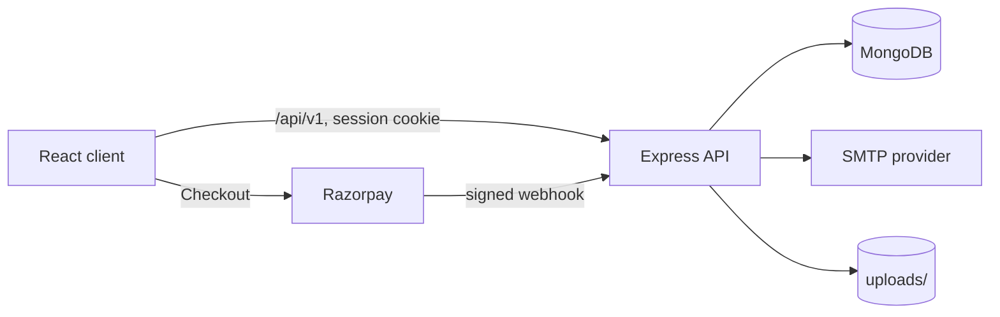

# Earthly

[](https://github.com/purnimakumarr/earthly/actions/workflows/ci.yml)

A booking platform for small-group, low-impact expeditions across India. Travelers browse expeditions, see each route on a map, pay through Razorpay and review the trips they have taken. Guides and admins manage the catalogue through the same API.

The project is backend-first: a REST API in Node.js, Express and MongoDB, with a small React client on top.

## What the backend does

- **Authentication.** JWT sessions in an httpOnly, SameSite cookie (or a bearer token for API clients), bcrypt password hashing, and sessions that stop working when the password changes or the account is deactivated.
- **Password reset.** Single-use tokens that expire after 10 minutes. Only a SHA-256 hash of the token is stored, and the endpoint answers the same way whether or not the email exists.
- **Role-based access.** Four roles (`traveler`, `guide`, `lead`, `admin`) enforced per route. Travelers can only edit their own reviews.
- **Payments.** The server creates the Razorpay order, so the client never sets the amount. The payment is confirmed twice, by the browser callback and by a webhook, each with HMAC-SHA256 signature checks in constant time. An upsert on a unique order id makes sure the two paths produce exactly one booking.
- **Query API.** Filtering, range operators, sorting, field selection and pagination from the query string, shared by every list endpoint through one query builder and a generic CRUD factory.
- **Geospatial queries.** Expeditions within a radius (`$geoWithin` on a 2dsphere index) and distances from any point (`$geoNear`).
- **Aggregation.** Price and rating statistics per difficulty, departures per month, and ratings that are recalculated whenever a review is created, edited or deleted.
- **Uploads.** Images are received in memory, resized and re-encoded with sharp before they reach the disk.
- **Hardening.** Helmet with a strict Content Security Policy, rate limiting (stricter on credential endpoints), NoSQL-injection and parameter-pollution guards, body size limits, and markup stripped from free-text fields.
- **Operations.** Environment validated at startup with zod, structured JSON logs with pino, a health endpoint, graceful shutdown, a Docker image and CI.

## Architecture



```
src/
  server.js        process start-up, DB connection, graceful shutdown
  app.js           middleware pipeline and route mounting
  config/          validated environment, logger
  routes/          one router per resource
  middleware/      auth, uploads, error handler
  controllers/     request handlers, plus the generic CRUD factory
  models/          Mongoose schemas, hooks and indexes
  services/        Razorpay client and signature checks
  utils/           QueryBuilder, ApiError, asyncHandler, mailer
  emails/          transactional email templates
client/            React + Vite + Tailwind single-page app
seed/              demo data and the seed script
tests/             Jest + Supertest integration tests
docs/openapi.yaml  API reference, served at /api/docs
```

In production the API also serves the built client, so the whole thing is one deployable on one origin.

## Run it locally

### With Docker

```bash
docker compose up --build
```

This starts MongoDB, loads the demo data and serves the site at <http://localhost:3000>. Payments need Razorpay test keys; everything else works without any configuration.

### Without Docker

Requires Node 22 and a MongoDB instance (local or Atlas).

```bash
cp .env.example .env        # then fill in MONGODB_URI and JWT_SECRET
npm install
npm install --prefix client
npm run seed                # load demo data
npm run dev                 # API on :3000, client on :5173
```

Open <http://localhost:5173>.

### Demo accounts

Every seeded account uses the password `earthly-demo-2026`.

| Role | Email |
|---|---|
| Traveler | `kavya@example.com` |
| Guide | `rohan@earthly.example` |
| Lead | `tenzin@earthly.example` |
| Admin | `admin@earthly.example` |

For payments, use a [Razorpay test card](https://razorpay.com/docs/payments/payments/test-card-details/).

## API reference

Interactive documentation is served at [`/api/docs`](http://localhost:3000/api/docs) from [`docs/openapi.yaml`](docs/openapi.yaml). A few examples:

```bash
# Easy expeditions under ₹40,000, cheapest first, two fields only
curl "localhost:3000/api/v1/expeditions?difficulty=easy&price[lte]=40000&sort=price&fields=name,price"

# Expeditions that start within 300 km of Guwahati
curl "localhost:3000/api/v1/expeditions/nearby?latlng=26.1445,91.7362&distance=300&unit=km"

# Price and rating summary per difficulty
curl "localhost:3000/api/v1/expeditions/stats"
```

## Tests

```bash
npm test
```

62 integration tests run the real Express app against an in-memory MongoDB. They cover the authentication and reset flows, role checks, the query API, geospatial and aggregation endpoints, rating recalculation, and the payment path, including forged signatures and the webhook and browser reporting the same payment at once.

## Deploying

The repository includes a `Dockerfile` and a `render.yaml` blueprint for [Render](https://render.com), with MongoDB Atlas as the database.

1. Create a free Atlas cluster and copy its connection string.
2. On Render, create a Blueprint from this repository and fill in the environment variables it asks for (see `.env.example`).
3. Run `npm run seed` once with `MONGODB_URI` pointing at Atlas.
4. In the Razorpay dashboard, add a webhook for `payment.captured` pointing to `https://<your-host>/api/v1/webhooks/razorpay` and set the same secret as `RAZORPAY_WEBHOOK_SECRET`.

Uploaded photos are stored on the instance's disk and are lost on redeploy on a free plan; object storage is the next step.

## Tech stack

Node.js, Express, MongoDB, Mongoose, JSON Web Tokens, Razorpay, sharp, Nodemailer, zod, pino, Jest, Supertest, React, Vite, Tailwind CSS, Leaflet, Docker, GitHub Actions.

## Credits

Expedition photos are from Wikimedia Commons under Creative Commons licences; see [CREDITS.md](CREDITS.md). Map tiles © OpenStreetMap contributors. The expeditions, people and reviews are fictional.
